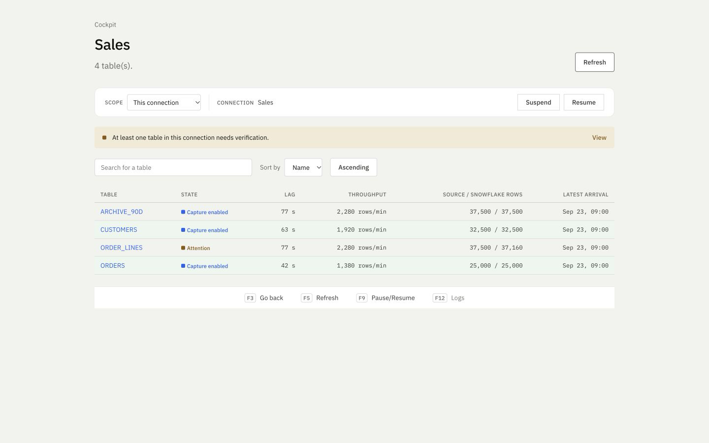

# Quadringent

Quadringent copies changes from IBM i to Snowflake and shows evidence of
progress: journal reading, raw storage, loading and reconciliation. It is
designed for data teams running their own IBM i, AWS or GCP, and Snowflake.

Active capture does not guarantee that the destination is up to date. The
cockpit distinguishes these states and shows **Not measured** when evidence
is missing.

*Development cockpit with its built-in demonstration: fictional connections
and measurements.*

**Community edition · DEV/INT preview.** Release availability and preview or
stable status are listed in [Releases](https://github.com/quadringent/quadringent-ce/releases).
The engine, API and local cockpit are open source under [Apache-2.0](LICENSE),
with no license key or commercial table limit. Operators pay their own
infrastructure costs. No production qualification is claimed.

The current preview is **0.3.4**. Its observed DEV/INT scope and outstanding
checks are recorded in the [dated qualification summary](site/qualification-0.3.4.json).
Historical measurements apply only to their original artifacts and scopes.

Contributions use the same license. Separate services or advanced extensions
may be paid offerings in the future; rights granted on published versions
remain in place. See the [project model](docs/licensing.md) and
[dependency notices](THIRD_PARTY_NOTICES.md).

## Community and the proposed first pilot

The engine, API and cockpit remain available under Apache-2.0. The first
proposed service is a **fixed-scope pilot: installation and validation on the
customer's infrastructure**, with support agreed separately if needed.
No paid offering, price or SLA is currently announced.

### Discuss a DEV/INT pilot

Email [quadringent@proton.me](mailto:quadringent@proton.me?subject=DEV%2FINT%20pilot)
to talk privately, without a GitHub account. A
[public pilot interest request](https://github.com/quadringent/quadringent-ce/issues/new?template=pilot_interest.yml)
on GitHub is also possible; the issue and your account name are publicly visible.
Send no credentials, access, private hostnames, customer data or attachments.

What happens next is a technical discovery exchange, then a written scope, then
a separate pilot decision. A request is never accepted automatically, and there
is no response-time commitment. The
[pilot preparation guide](docs/product/positioning-and-offer.md) lists the
tables, access, infrastructure budget, acceptance criteria and deliverables to
prepare.

## Try the cockpit locally

From a repository clone, with Python 3.12+ and Node 24 or 26:

~~~sh
python3 -m venv .venv
.venv/bin/python -m pip install .
npm ci --prefix ui
npm run build --prefix ui
sh scripts/start_local.sh
~~~

Open <http://127.0.0.1:8844>. The cockpit is empty on first start.
The configuration in `examples/local.env` is fictional; these commands do not
contact IBM i, AWS or Snowflake. A connection created in Installation is saved
locally as **configured, not active yet**. The `.local-state/` directory retains
configured connections across restarts.

For actual systems, follow the [installation guide](docs/product/install-client.md).
It distinguishes prerequisites, configuration and replication evidence.

## Observed preview results — October 12, 2026

The published 0.3.2 artifacts installed on AWS VM, EKS, GCP VM and GKE.
Two synthetic journaled tables, 110 initial typed rows per site, native
INSERT/UPDATE/DELETE and actual reader termination with acknowledged writes
inside the outage were checked by complete destination reads, without duplicates.
Upgrade to 0.3.3, rollback to 0.3.2 and upgrade to 0.3.4 retained pipeline
identities, PostgreSQL volumes, original keys and typed history on all four sites.
The 0.3.4 readback matched all **136 history images and 110 mirror rows per site**.

In one 0.3.4 trial with all four Snowflake loader warehouses initially suspended,
the maximum independently observed SQL-start → destination visibility was
**11.207 s / 8.520 s / 13.641 s / 11.802 s**, respectively. These are observation
upper bounds across six source writes and twelve history/mirror signals per site.
The 10 s gate failed on three targets. Including source-client startup, maxima
were **16.466 s / 13.936 s / 18.795 s / 16.863 s**; all four exceeded 10 s.
Readers and loaders were already running. This is not an application-startup test,
a universal latency guarantee or production qualification. Reader-failure and
complete site reconstruction still require repetition on 0.3.4.

## Historical measurements from October 5–6, 2026

These results cover isolated personal DEV/INT installations. They do not
guarantee ten seconds for every workload, startup or configuration and do not
qualify production.

| Version / test | Observed result and scope |
|---|---|
| 0.2.18 | Thirty native updates over ten minutes on AWS VM, EKS, GCP VM and GKE: 120 IBM i acknowledgement → Snowflake mirror observations, **2.317–7.992 seconds**. Complete reads checked typed data, retained prior events and absence of duplicates. |
| 0.2.15 → 0.2.13 → 0.2.15 | Upgrade and rollback cycles on the relevant sites retained data and identities. |
| 0.2.16 | Reconstruction after complete loss of the four sites restored PostgreSQL and original keys, retained RAW and external checkpoints without regression. Continuity was subsequently read back with 0.2.18 and 0.2.19. |
| 0.2.19 | Public artifacts admitted and deployed on all four sites. One new native write became visible in every mirror in **4.904–7.041 seconds**. Eight source/history/mirror reads checked all seven typed columns, prior events and no duplicates. Each authenticated cockpit showed one metric and three logs from the actual Kubernetes loader. This single-write check is separate from the thirty-write 0.2.18 campaign. |
| 0.2.17 on AWS VM | Recopy data and the historical oracle were verified. Its Job expired before the full API inventory was archived; no strict verification of that historical inventory is claimed. |
| 0.2.22 | Public artifacts installed on the four sites and a fifth fresh wizard installation. One write reached all five mirrors in **5.013–7.776 seconds after IBM i acknowledgement**, or at most **7.827 seconds including the JDBC statement start**. Container startup and source authentication are excluded; this is not a cold-start measurement. Five complete reads checked 110 typed source rows, retained prior events and no duplicates. Historical RAW coverage remains partial on AWS VM and the wizard site. |
| 0.2.22 isolated restore on GCP VM | A backup restore retained identities, keys and four configured tables, with only one installation active during each readback. This differs from the complete 0.2.16 reconstruction tests. |
| 0.2.19 fresh wizard installation | Activation, sign-in and the IBM i TLS probe were verified. These measurements do not cover its fresh copy or the autonomous harness; those paths require separate qualification. |

Release notes define the verified scope of each batch.

### Earlier historical results

An earlier GKE DEV test used synthetic tables and a different loading profile.
It measured **6.35–31.31 seconds** to the mirror; it does not describe the native
0.2.18 campaign above.

Version 0.2.5 was verified in DEV on GKE, EKS, GCP VM and AWS VM: installation,
upgrade 0.2.3 → 0.2.5, rollback to 0.2.3, complete loss of the original site
and reconstruction of a fresh site from public 0.2.5 artifacts. Restoring a
0.2.5 backup and keys exported off-site was checked against the control plane
database, including sign-in, synthetic data parity and decryption. This
lifecycle evidence does not qualify 0.2.5 CDC or production stability.
PostgreSQL/PVC UIDs were not measured directly on AWS VM; child/config digests
remain derived from sealed artifacts where no direct runtime read was made.

## Scope

- Java/JTOpen reading over TLS, raw S3 or GCS storage and a durable checkpoint.
- Targets qualified by batch: AWS VM, EKS, GCP VM and GKE, in DEV/INT.
- Capture and reconciliation into Snowflake, dated evidence and explicit scope.
- Desktop cockpit (1440 px reference), `/v1` API and connection configuration.
- Capability-driven actions, confirmation and an audit log.
- Snowflake credits over 24 h, ending at least 6 h before observation,
  converted at the site's configured rate.
- S3 Standard: CloudWatch volume and a monthly estimate at constant volume
  using the observed public AWS rate. OpenCost: Quadringent namespace
  allocation, contextual cluster total and unused resources. Collection is
  optional; calculations are not a bill.

The runtime permits `dev`, `int`, `test` and `staging`. The chart requires a
namespace matching `site.namespace` and blocks production promotion; examples
use `dev` and `quadringent-demo`. The v1 cockpit uses loopback **without
authentication by default**: read [Security](SECURITY.md) before exposing
access or granting action permissions.

## Documentation

- [Static presentation](site/index.html): after `npm ci --prefix ui` (fonts),
  serve the root with `python3 -m http.server 8860 --bind 127.0.0.1`, then open
  `/site/`. Its [visual system](docs/design-system.md) derives from cockpit tokens.
- [Architecture](docs/architecture.md), [API](docs/api.md), [FinOps](docs/finops.md).
- [Operations and recovery](docs/operations.md), [Security](SECURITY.md).
- [Qualify native pods and recovery](docs/product/native-qualification.md):
  admitted images, cloud identities, source/destination reconciliation and
  latency measurements backed by private evidence.
- [Contributing and testing](CONTRIBUTING.md), [Changes](CHANGELOG.md),
  [Releases and delivery](docs/releasing.md).

Use `python -m pytest -q` after `python -m pip install -e '.[dev,api]'`.
Java and UI checks are documented in CONTRIBUTING. Experiments under
`research/` are excluded from the product wheel.
