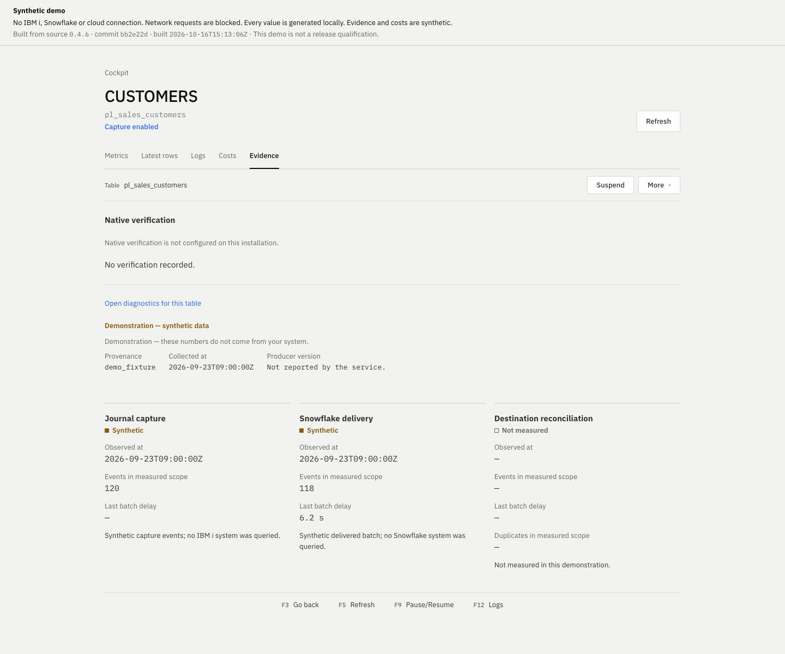

# Quadringent

**A running reader doesn't mean your data arrived.** Quadringent tracks journal reading, Snowflake delivery and reconciliation separately, and says "Not measured" instead of showing a green light it cannot back up.

We build open-source change data capture from IBM i (formerly AS/400 and iSeries) journals to Snowflake. It needs no Kafka and no license key, and it runs in your own AWS or GCP account. For each table the cockpit shows what the journal reader saw, what reached Snowflake and whether the two were reconciled, and it marks a stage Not measured when we have no evidence for it. Reconciliation counts events; it does not compare business values by key. It is for data teams that run their own IBM i and Snowflake and want the pipeline on AWS or GCP.

<!-- The opening paragraph is also the opening of docs/pypi.md; edit both together. tests/test_pypi_metadata.py checks that they match. -->
<!-- source: docs/architecture.md, docs/licensing.md, docs/product/your-data.md, docs/product/quadringent-destination-proof-contract.md -->

Status: Preview, DEV/INT only. We claim no production qualification. Source version 0.4.2 needs fresh qualification; the latest observed releases are 0.3.5 (initial copy) and 0.3.4 (recovery), both 2026-10-12; native CDC writes on 0.3.5 are Not tested. Dates, tables and limits are in [docs/evidence.md](docs/evidence.md).

In the 0.3.4 cold-warehouse trial, 3 of 4 targets missed our 10 s latency bar; a later run passed on all four. The IBM i CPU and I/O cost of the reader is Not measured. Only IBM i 7.5, on one shared server, has been tested, in a historical measurement on one table, and no published summary names the release.

<!-- source: docs/evidence.md, site/runtime-0.3.5.json, site/recovery-0.3.4.json, site/qualification-0.3.4.json, pyproject.toml -->

<picture>
  <source media="(prefers-color-scheme: dark)" srcset="site/assets/cockpit-evidence-dark.png">
  
</picture>

The Evidence tab of the synthetic demo: 120 events read, 118 delivered, reconciliation Not measured. Every value is generated.

## Try it

The synthetic demo runs the real cockpit on generated data. It makes no IBM i, Snowflake or cloud connection, and the page blocks network requests. From a clone of this repository, with Node 24 or 26:

~~~sh
npm ci --prefix ui
node ui/scripts/build-demo.mjs --serve
~~~

Open <http://127.0.0.1:8870/#/cockpit>. The [demo guide](docs/product/synthetic-demo.md) lists what it shows.

`quadringent doctor` reads what your machine can see and changes nothing. This is real output against a placeholder host that does not resolve, shortened:

~~~text
Quadringent doctor: BLOCKED  (10 failed, 1 unknown, 1 skipped, 0 passed)
[FAIL] network.tcp.signon [host signon 9476/tcp]: TCP connection to port 9476 failed: host name not resolved.
       Next: Check the IBM i host name and the DNS used by this machine and by the reader.
[UNKN] authentication.ibmi_signon [host ibmi.example.test]: IBM i sign-on was not tested; configured credentials are not proof of authentication.
~~~

See [preflight and diagnosis](docs/product/operator-guide.md#2-preflight-and-diagnosis). To copy one table on one machine with Docker, use `quadringent local` ([Try it on one machine](docs/product/try-it-local.md)). Both commands are listed under Unreleased in the [changelog](CHANGELOG.md), and `quadringent local` has not been validated end to end against a real IBM i and Snowflake.

<!-- source: docs/product/synthetic-demo.md, docs/product/operator-guide.md, docs/product/try-it-local.md, CHANGELOG.md -->

To run the empty local control plane from a clone, with Python 3.12+ and Node 24 or 26:

~~~sh
python3 -m venv .venv
.venv/bin/python -m pip install .
npm ci --prefix ui
npm run build --prefix ui
sh scripts/start_local.sh
~~~

Open <http://127.0.0.1:8844>. The cockpit is empty on first start, and `examples/local.env` is fictional: nothing contacts IBM i, AWS or Snowflake. A connection created in Installation is saved locally as configured, not active yet, and `.local-state/` keeps it across restarts.

## Install on a real site

Read the [compatibility page](docs/product/compatibility.md) first; every row says Tested, Required or Not tested. Then follow the [installation guide](docs/product/install-default.md), or the [Helm guide](docs/product/install-client.md) if you manage your own values. The v1 cockpit listens on loopback without authentication by default, so read [Security](SECURITY.md) before you expose it.

Moving to 0.4.2 changes native capture configuration and checkpoint semantics. It requires the original admitted receiver binding and refuses automatic adoption of legacy v1 checkpoints. Keep the previous version and its state until a migration has been verified; the [native capture guide](docs/product/native-qualification.md) explains how.

## Trust and verification

Start with the IBM i footprint, then your data, release verification and governance.

- [What Quadringent does on your IBM i](docs/product/ibm-i-footprint.md), start here.
- [Your data: where it goes and how to leave](docs/product/your-data.md).
- [Verify a release against the public code](docs/product/verify-a-release.md).
- [Governance and continuity](docs/governance.md), including what remains if the maintainers stop.
- [Support](SUPPORT.md), including what we do not offer.
- [Security policy](SECURITY.md), including the response target.

## Questions, comparisons, background

The [FAQ](docs/product/faq.md) answers what a first call asks, and every answer carries a status. [How Quadringent compares](docs/product/comparison.md) sets us beside other options, with each claim about another product tied to its vendor's documentation. For background, read [how IBM i journals work for change data capture](docs/articles/ibm-i-journals-for-cdc.md), [why capture is not delivery](docs/articles/capture-delivery-reconciliation.md) and [options to replicate AS/400 (IBM i) data to Snowflake](docs/articles/as400-to-snowflake-options.md).

## License and the first pilot

The engine, API and cockpit are open source under [Apache-2.0](LICENSE), with no license key or commercial table limit. You pay your own infrastructure costs. Contributions use the same license. Separate services or advanced extensions may become paid offerings later; rights granted on published versions stay in place. See the [project model](docs/licensing.md) and the [dependency notices](THIRD_PARTY_NOTICES.md). Release availability, and whether a release is preview or stable, is listed in [Releases](https://github.com/quadringent/quadringent-ce/releases).

The first service we propose is a fixed-scope pilot: installation and validation on your infrastructure, with support agreed separately if needed. No paid offering, price or SLA is announced.

### Discuss a DEV/INT pilot

Email [quadringent@proton.me](mailto:quadringent@proton.me?subject=DEV%2FINT%20pilot) to talk privately, without a GitHub account. A [public pilot interest request](https://github.com/quadringent/quadringent-ce/issues/new?template=pilot_interest.yml) on GitHub also works; the issue and your account name are publicly visible. Send no credentials, access, private hostnames, customer data or attachments.

What happens next is a technical discovery exchange, then a written scope, then a separate pilot decision. We never accept a request automatically and we commit to no response time. The [pilot preparation guide](docs/product/positioning-and-offer.md) lists the tables, access, infrastructure budget, acceptance criteria and deliverables to prepare.

## Documentation and contributing

[Architecture](docs/architecture.md), [API](docs/api.md), [FinOps](docs/finops.md), [operations and recovery](docs/operations.md), [releases and delivery](docs/releasing.md) and the [changelog](CHANGELOG.md). The static [presentation site](site/index.html) derives its [visual system](docs/design-system.md) from the cockpit tokens; after `npm ci --prefix ui` (fonts), serve the root with `python3 -m http.server 8860 --bind 127.0.0.1` and open `/site/`.

To contribute, read [CONTRIBUTING.md](CONTRIBUTING.md) and run `python -m pytest -q` after `python -m pip install -e '.[dev,api]'`. Java and UI checks are in CONTRIBUTING. Experiments under `research/` are excluded from the product wheel.
